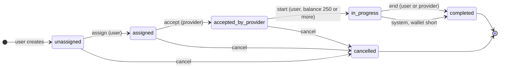

# Pay As You Go: Demo Guide

A prepaid wallet with per-minute session billing. A user tops up a wallet, books a provider, and pays Rs 50 for every full minute. When the wallet cannot cover the next minute, the system ends the session.

## Actors

| Actor | Role |
|---|---|
| User | Recharges, creates the session, assigns a provider, starts and ends it. Pays. |
| Provider | Accepts the assigned session. Can end or cancel it. Never pays. |
| Payment gateway (mock) | Calls the webhook when a recharge succeeds or fails. No login. |

## Session state machine



Any action from a state not drawn here returns `400` with a message naming the current state. The transition table is `TRANSITIONS` in [sessions_app/services.py](sessions_app/services.py).

## Billing clock

Each bill call charges `floor(elapsed / 60) - billed_minutes` minutes. Only full minutes are charged.

Example: rate Rs 50, wallet Rs 260.

| Minute | 1 | 2 | 3 | 4 | 5 | 6 |
|---|---|---|---|---|---|---|
| Charge | -50 | -50 | -50 | -50 | -50 | stop |
| Wallet after | 210 | 160 | 110 | 60 | 10 | 10 |

At minute 6 the wallet holds Rs 10, below Rs 50. Nothing is debited, the session ends as `system:insufficient_balance`, and the balance stays at Rs 10.

- Billing the same minute twice charges nothing the second time, because `billed_minutes` has already advanced.
- A partial last minute is free. `billable_seconds` still records the real talk time.

## Money safety

Every rule is enforced in the service code and again in the database.

| Risk | Service layer | Database layer |
|---|---|---|
| Negative balance | Debit refuses when balance is short | `CHECK balance >= 0` |
| Duplicate recharge | Lock the row, credit only while `pending` | Unique `reference` |
| Minute billed twice | `billed_minutes` counter | Unique (`session`, `minute_index`) on debits |
| Two live sessions | Check before start | Partial unique where `in_progress` |
| Concurrent requests | `select_for_update`, session then wallet | Row locks |

## Running the demo

Prepare once:

```bash
uv sync
uv run python manage.py migrate
uv run python manage.py test        # expect OK after 38 tests
```

Then use two terminals:

```bash
uv run python manage.py runserver   # terminal 1
./demo.sh                           # terminal 2, press Enter between steps
```

- `NOPAUSE=1 ./demo.sh` runs without pauses, for a dry run.
- Usernames are randomized, so the demo can be re-run without resetting the database.
- The "time passes" steps move `started_at` back in the dev database. Nothing sleeps.
- Requires `python3` and `curl`.

## Demo order (about 8 to 10 minutes)

| # | Step | What to say |
|---|---|---|
| 1 | Register a user and a provider | Roles decide who may call which endpoint. |
| 2 | Recharge Rs 500, wallet still 0 | The recharge is pending until the gateway calls back. |
| 3 | Send the same callback twice | Balance stays 500. This is idempotency. |
| 4 | Create, assign, accept, start | A provider trying to start gets 403. The rate is fixed at start. |
| 5 | Rewind 2 minutes, bill twice | Charged once: `billed_minutes` is 2, total Rs 100. |
| 6 | End the session | Wallet shows 400. Ending again returns a state-machine error. |
| 7 | Second user with Rs 260 runs dry | Rs 240 cannot start. After top-up, minute 6 ends the session and the wallet stays at 10. |

Close with a short code tour:

- State machine: [sessions_app/services.py:17](sessions_app/services.py#L17)
- Billing loop `_bill`: [sessions_app/services.py:116](sessions_app/services.py#L116)
- DB constraints: [wallet/models.py:12](wallet/models.py#L12) and [wallet/models.py:52](wallet/models.py#L52)

Then run the tests. Billing takes `now` as a parameter, so no test sleeps.

## Likely questions

| Question | Answer |
|---|---|
| How do you handle concurrency? | `select_for_update` on the session and then the wallet, always in that order, with unique constraints as a backstop. |
| Why is billing lazy? | It avoids a long-running worker. In production, schedule `bill_active_sessions` with cron or Celery beat. |
| Is the webhook secure? | Not yet. A real gateway needs HMAC signature verification. |
| What about SQLite and row locks? | SQLite ignores row locks, so production should use PostgreSQL. |
| Why snapshot the rate on the session? | A price change cannot alter a session already running. |

## Demo with Postman

Use Postman instead of `demo.sh` when you want the interviewer to see each request and response.

### Setup (once)

1. Start the server: `uv run python manage.py runserver`.
2. In Postman choose **Import** and select [postman/pay-as-you-go.postman_collection.json](postman/pay-as-you-go.postman_collection.json).
3. The collection variable `base_url` is `http://127.0.0.1:8000`. Change it if your port differs.

Tokens, the provider id, the recharge reference and the session id are saved automatically by each request's test script. You never copy them by hand. Usernames get a random suffix, so you can rerun without resetting the database.

### Running it

Send the requests one at a time, in order, and open the **Test Results** tab on each. Every request has assertions, so a green tick means the behavior is proven.

| Folder | What it shows |
|---|---|
| 1. Setup | Register a user and a provider. |
| 2. Wallet and idempotent recharge | Pending recharge leaves the balance at 0. The callback is sent twice and the balance stays 500. |
| 3. Session lifecycle and billing | Role check (403), state machine (400), start, bill twice, end, wallet 400. |
| 4. Error cases | 401, 403, 400 and 404 responses. |

### The one manual step: moving the clock

Postman cannot move time forward. After **Start (user)** and before **Bill (after 2 minutes)**, run this in a terminal:

```bash
./rewind.sh 1 130
```

Use the session id shown in the **Start (user)** response (`id`) in place of `1`. The alternative is to wait two real minutes, which works but is slow in an interview.

### Optional: run it all at once

Use **Runner** on the collection and pause to run `./rewind.sh` before the bill request. Or, with `newman` installed, run the folders in two passes around the rewind.

### Show the auto-end case

Folder 3 covers the happy path. For the low-balance auto-end, send these by hand with a second user:

1. Recharge 240, try to start, and show the 400 "At least 250 is required".
2. Recharge 20 more and start.
3. `./rewind.sh <id> 320`, then Bill: 5 minutes, Rs 250 charged.
4. `./rewind.sh <id> 60`, then Bill: the session is `completed` with `ended_by: system:insufficient_balance` and the wallet stays at 10.
