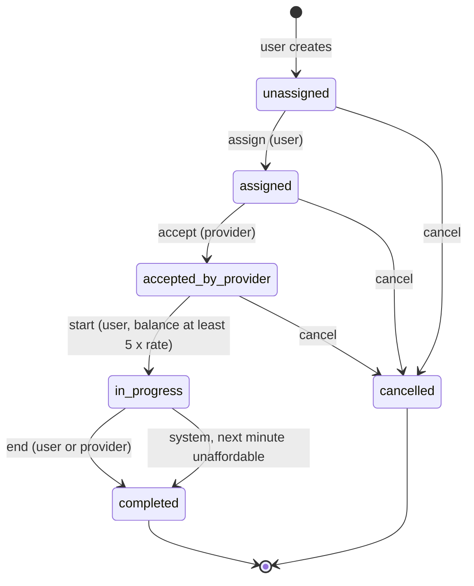
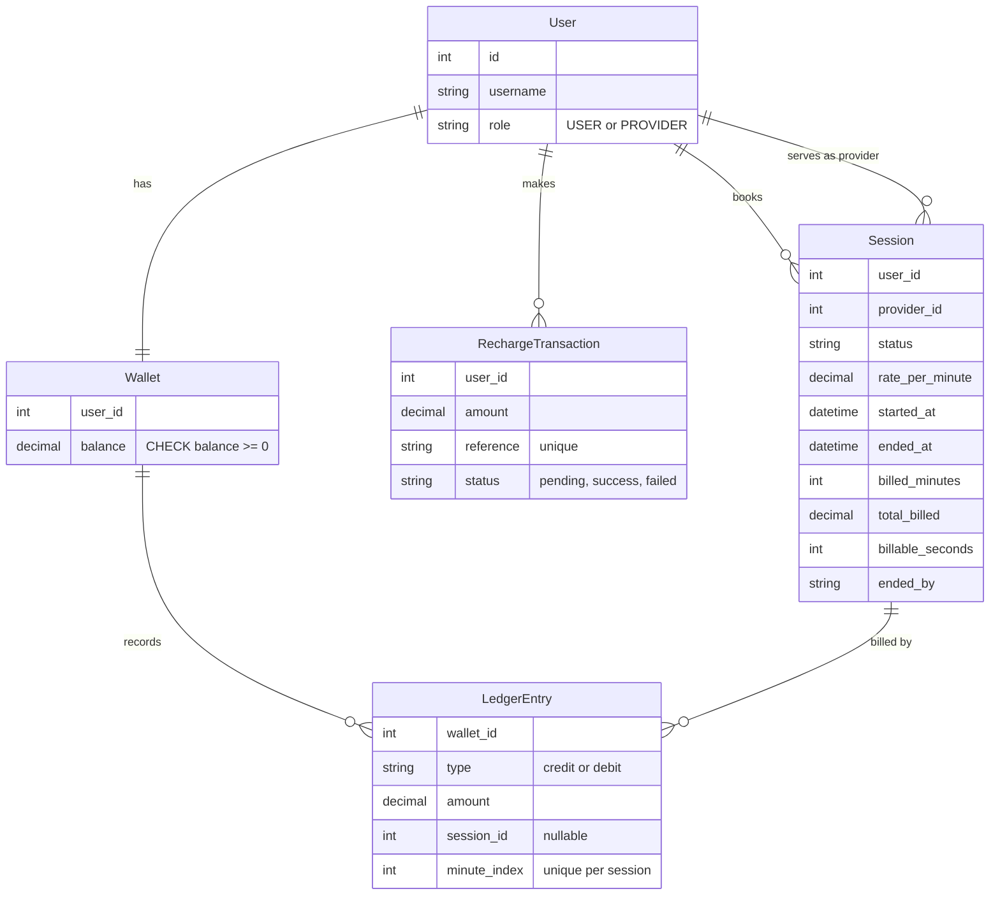

# Pay As You Go: Wallet-Based Per-Minute Session Billing

A Django REST backend for paid 1:1 consultation sessions. A user keeps a prepaid wallet, books a session with a provider, and is charged per minute while the session runs. If the wallet cannot cover the next minute, the system ends the session.

The focus is state management, wallet handling, billing logic, idempotency and tests. There is no UI and no real payment gateway.

## Build status

| Stage | Scope | Status |
|---|---|---|
| (a) | Project setup, users, roles, token auth | Done |
| (b) | Wallet, mock recharge, idempotent callback, ledger | Done |
| (c) | Session state machine | Done |
| (d) | Per-minute billing, auto-end | Done |
| (e) | Full test suite (6 required scenarios plus extras, 38 tests) | Done |
| (f) | Design notes ([DESIGN_NOTES.md](DESIGN_NOTES.md)) | Done |

All APIs below are implemented. See [plan.md](plan.md) for the design and [DESIGN_NOTES.md](DESIGN_NOTES.md) for decisions.

## Stack

- Python 3.12, Django 6.1, Django REST Framework
- SQLite for local development (PostgreSQL also works)
- Token authentication (`Authorization: Token <key>`)
- Package manager: [uv](https://docs.astral.sh/uv/)

## Setup

```bash
uv sync                              # install dependencies
uv run python manage.py migrate      # create the database
uv run python manage.py runserver    # http://127.0.0.1:8000
```

## Run the tests

```bash
uv run python manage.py test
```

Tests use DRF's `APIClient`. Billing tests pass the clock in as an argument, so nothing sleeps.

## Project layout

```
config/          settings, root urls, exception handler (domain errors -> HTTP 400)
accounts/        User model (role USER or PROVIDER), register, login, role permissions
wallet/          wallet, recharge transactions, ledger, credit and debit services
sessions_app/    session model, state machine, billing
```

Business logic lives in `services.py` inside each app. Views stay thin.

## Settings

| Setting | Default | Meaning |
|---|---|---|
| `SESSION_RATE_PER_MINUTE` | `50` | Price per minute. Copied onto the session when it starts, so it never changes mid-session. |
| `MIN_START_MINUTES` | `5` | A session needs a balance of at least this many minutes' worth to start (5 x 50 = Rs 250). |

## Conventions

- **Auth header:** `Authorization: Token <key>` on every endpoint except register and login.
- **Money:** Decimal values, serialized as strings (for example `"500.00"`). Never floats.
- **Errors:**

| Status | When | Body |
|---|---|---|
| 400 | Invalid input, invalid state transition, insufficient balance, bad login | `{"error": "<message>"}` or field errors |
| 401 | Missing or invalid token | `{"detail": "..."}` |
| 403 | Authenticated but wrong role or not the owner | `{"detail": "..."}` |
| 404 | Object not found | `{"detail": "..."}` |

---

## API reference

### Auth (accounts) · Implemented

#### `POST /auth/register/`

No auth required. Creates a user and returns a token.

Request:
```json
{ "username": "alice", "password": "S3cure-pass!", "role": "USER" }
```
`role` is `USER` (default) or `PROVIDER`. The password goes through Django's password validators.

Response `201`:
```json
{ "id": 1, "username": "alice", "role": "USER", "token": "9944b09199c62bcf9418ad846dd0e4bbdfc6ee4b" }
```

#### `POST /auth/login/`

No auth required.

Request:
```json
{ "username": "alice", "password": "S3cure-pass!" }
```
Response `200`:
```json
{ "token": "9944b09199c62bcf9418ad846dd0e4bbdfc6ee4b", "role": "USER" }
```
Wrong credentials return `400` with `{"error": "Invalid username or password."}`.

---

### Wallet · Implemented

#### `GET /wallet/`

Returns the caller's balance.

Response `200`:
```json
{ "balance": "500.00" }
```

#### `POST /wallet/recharge/`

Starts a mock recharge. Creates a `pending` transaction with a unique reference. The wallet is not credited yet.

Request:
```json
{ "amount": "500.00" }
```
Response `201`:
```json
{ "reference": "rch_8f3a1c", "amount": "500.00", "status": "pending" }
```
An amount of zero or less returns `400`.

#### `POST /wallet/recharge/callback/`

The mock payment webhook. It completes a recharge.

Request:
```json
{ "reference": "rch_8f3a1c", "status": "success" }
```
`status` is `success` or `failed`.

Behaviour (idempotent):
- The transaction row is locked inside `transaction.atomic()`.
- Stored status `pending` and callback `success`: credit the wallet, write a credit ledger entry, set `success`.
- Stored status `pending` and callback `failed`: set `failed`, no credit.
- Stored status already `success` or `failed`: no change, returns `200`. The same callback sent twice credits once.
- Unknown reference: `404`.

Response `200`:
```json
{ "reference": "rch_8f3a1c", "status": "success", "balance": "500.00" }
```

---

### Sessions · Implemented

Base object:
```json
{
  "id": 7,
  "user": 1,
  "provider": 2,
  "status": "in_progress",
  "rate_per_minute": "50.00",
  "started_at": "2026-11-02T10:00:00Z",
  "ended_at": null,
  "billed_minutes": 2,
  "total_billed": "100.00",
  "billable_seconds": 0,
  "ended_by": null
}
```

| Method and path | Who | From state | To state |
|---|---|---|---|
| `POST /sessions/` | USER | none | `unassigned` |
| `GET /sessions/<id>/` | owner or assigned provider | any | unchanged |
| `POST /sessions/<id>/assign/` body `{"provider_id": 2}` | owning USER | `unassigned` | `assigned` |
| `POST /sessions/<id>/accept/` | assigned PROVIDER | `assigned` | `accepted_by_provider` |
| `POST /sessions/<id>/start/` | owning USER | `accepted_by_provider` | `in_progress` |
| `POST /sessions/<id>/end/` | owning USER or assigned PROVIDER | `in_progress` | `completed` |
| `POST /sessions/<id>/bill/` | owner, provider | `in_progress` | `in_progress` or `completed` |
| `POST /sessions/<id>/cancel/` | owning USER, or assigned PROVIDER once assigned | `unassigned`, `assigned`, `accepted_by_provider` | `cancelled` |

Rules:
- Any action from a state not listed returns `400` with a message naming the current state. Example: `"Cannot end a session that is accepted_by_provider."`
- A wrong role or someone else's session returns `403`.
- **Start** requires a wallet balance of at least `MIN_START_MINUTES x SESSION_RATE_PER_MINUTE` (Rs 250), otherwise `400`. It also fails with `400` if the user already has an `in_progress` session. It sets `rate_per_minute` and `started_at`.
- **End** bills any full minutes still owed, then completes the session with `ended_by` set to `user` or `provider`.
- **Bill** charges every full elapsed minute that has not been charged yet.

#### Billing rules

```
elapsed_minutes = floor((now - started_at) / 60 seconds)
to_charge       = elapsed_minutes - billed_minutes
```

For each minute to charge:
- If `balance >= rate`: debit the rate, add 1 to `billed_minutes`, write a ledger entry.
- Otherwise: do not debit. End the session as `completed` with `ended_by = "system:insufficient_balance"` and stop.

Calling bill twice for the same minute charges nothing the second time, because `billed_minutes` has already advanced. Only full minutes are charged, so a partial last minute is free. `billable_seconds` still records the real talk time.

Example: rate Rs 50, balance Rs 260. Five bills leave Rs 10. At the sixth minute the balance is below 50, so the session ends with the wallet still at Rs 10.

Billing can also run from the command line:
```bash
uv run python manage.py bill_active_sessions
```

---

## Session state machine



## Data model



## How the money is protected

| Risk | Service layer | Database layer |
|---|---|---|
| Negative balance | Debit refuses when balance is below the amount | `CheckConstraint(balance >= 0)` |
| Duplicate recharge credit | Lock the row, credit only while `pending` | Unique `reference` |
| Same minute billed twice | `billed_minutes` counter | Unique (`session`, `minute_index`) on the ledger |
| Two active sessions for one user | Check before start | Partial unique on `user` where status is `in_progress` |
| Concurrent requests | `transaction.atomic()` and `select_for_update()`, always session then wallet | Row locks |

## Quick try-out

```bash
curl -X POST http://127.0.0.1:8000/auth/register/ \
  -H "Content-Type: application/json" \
  -d '{"username": "alice", "password": "S3cure-pass!", "role": "USER"}'

curl -X POST http://127.0.0.1:8000/auth/login/ \
  -H "Content-Type: application/json" \
  -d '{"username": "alice", "password": "S3cure-pass!"}'
```

## Out of scope

Real payment gateway, real-time chat, audio and video, frontend, admin panel, production background workers, multiple currencies.
