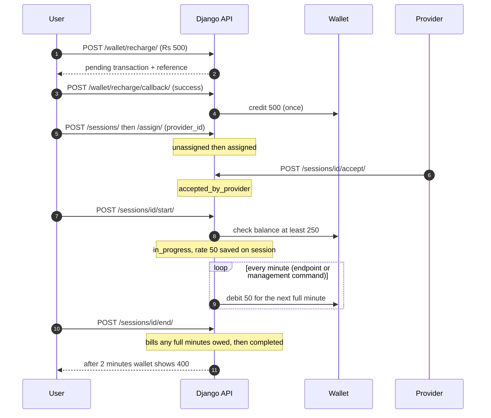
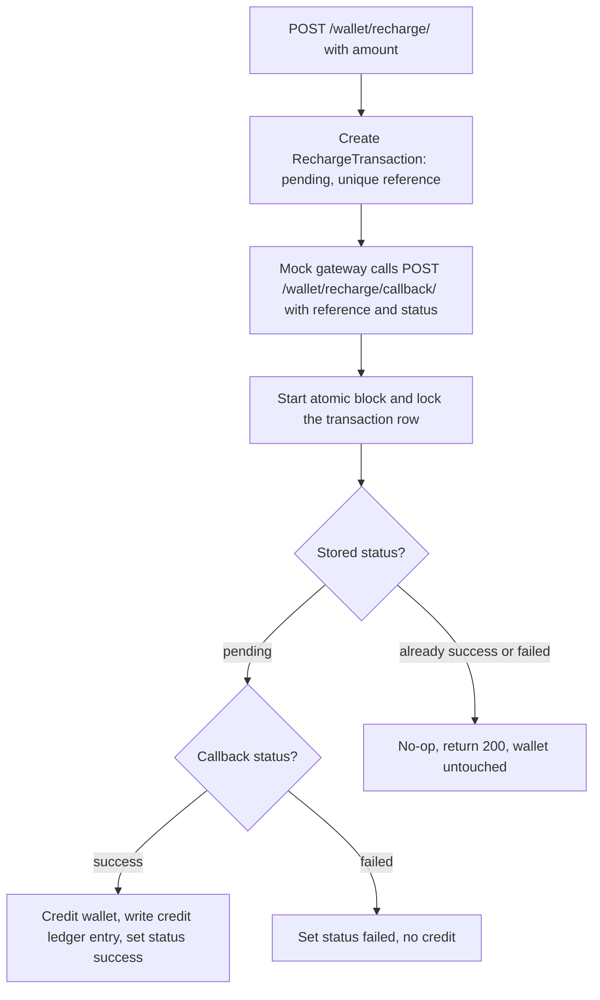
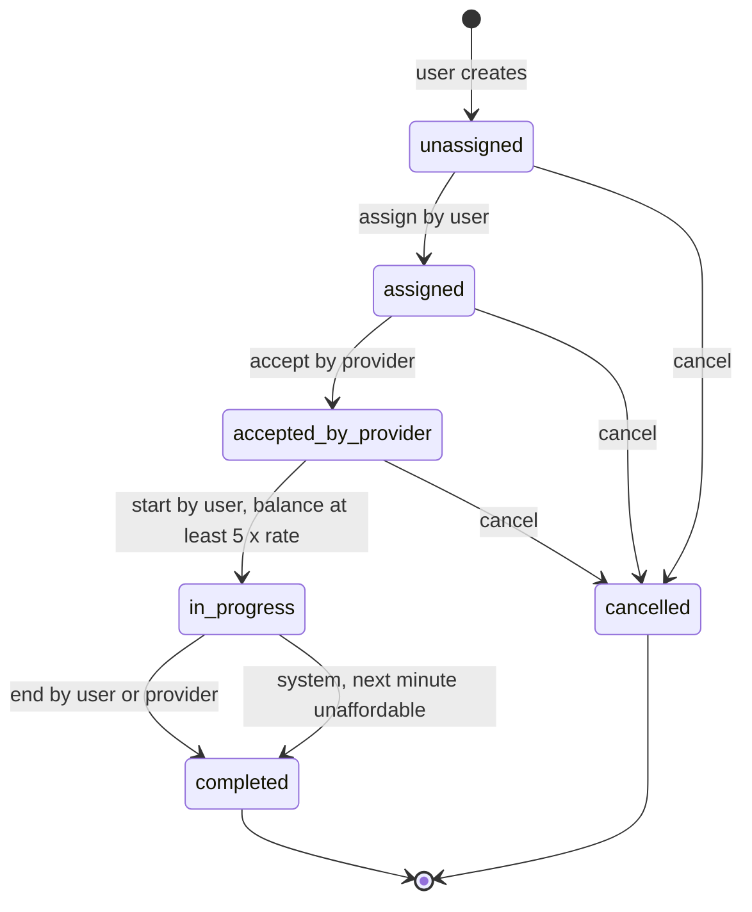
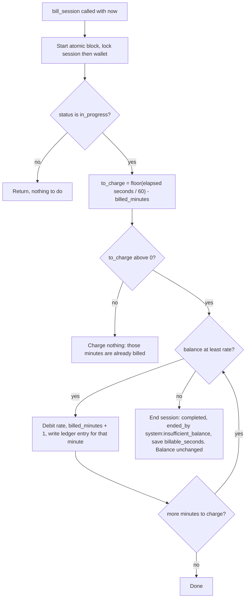

# How a paid session works, start to finish

Wallet, session state machine and per-minute billing for the Django assignment. Example numbers: rate Rs 50 per minute, so a session needs at least Rs 250 to start.

1 · The whole journey

## Happy path: recharge, book, talk, pay

Every arrow into the wallet goes through one locked, atomic service function. Nothing else can change the balance.

2 · Money in

## Recharge, and why a repeated callback is harmless

The row lock makes two simultaneous callbacks queue up. The second one sees `success` and does nothing, so the wallet is credited once.

3 · Session states

## The state machine

Any arrow not drawn here is rejected with HTTP 400 and a message naming the current state. Example: ending a session that is still `accepted_by_provider`.

| Action | Who may call it | Wrong person gets |
| --- | --- | --- |
| assign, start, cancel (before start) | The user who owns the session | 403 |
| accept | The provider the session is assigned to | 403 |
| end | Owning user or assigned provider | 403 |
| bill | Owner, provider, or the management command | 403 |

4 · Money out

## Billing one call at a time

Calling it twice in the same minute: the second call computes `to_charge = 0` because `billed_minutes` already moved. A unique (session, minute) ledger constraint backs that up in the database.

5 · Running out of money

## Example: Rs 260 in the wallet, Rs 50 per minute

| Elapsed | Action | Wallet | billed_minutes |
| --- | --- | --- | --- |
| 0:00 | Start allowed (260 is at least 250). Rate 50 is saved. | 260 | 0 |
| 1:00 to 5:00 | Five bills, one per minute | 10 | 5 |
| 6:00 | Bill: balance 10 is below 50. Session ends, ended_by system:insufficient_balance. | 10 (never negative) | 5 |

6 · Safety nets

## What protects the money, in layers

| Risk | Service layer | Database layer |
| --- | --- | --- |
| Negative balance | Debit refuses if balance is below amount | CheckConstraint balance at least 0 |
| Duplicate recharge credit | Lock row, credit only if pending | Unique reference |
| Same minute billed twice | billed_minutes counter | Unique (session, minute_index) on ledger |
| Two active sessions | Check before start | Partial unique on user where in_progress |
| Races between requests | atomic + select_for_update, always session then wallet | Row locks |

7 · Edge cases from the review

## Details to settle in the code

- A user ends a session that bill already auto-ended: the second call gets 400, because the state is already `completed`. Correct, and worth a test.
- A `failed` callback after a `success` one, or the reverse, must not change anything. Only `pending` can move.
- Partial last minute: free (full minutes only). `billable_seconds` still stores the real talk time.
- On auto-end, `billable_seconds` is set to billed minutes times 60, since the unpaid minute was not talk time the user paid for.
- Callback endpoint: no auth in the mock, so it should only accept references that exist and return 404 for unknown ones.
- Always lock in the same order (session, then wallet) so two requests cannot deadlock.