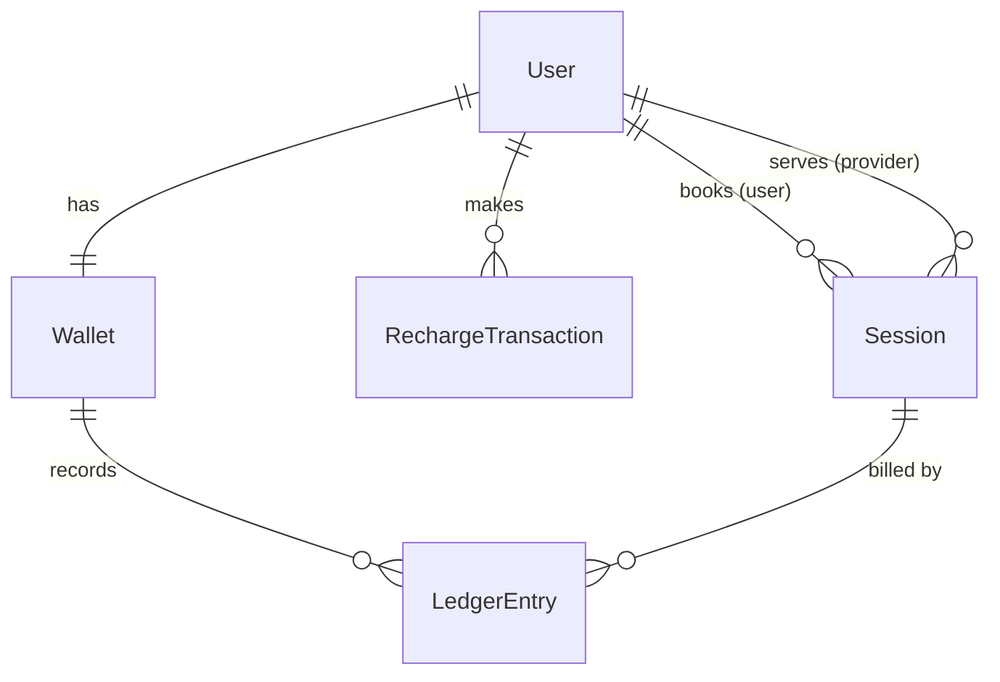

# Plan: Wallet-Based Per-Minute Session Billing

How everything fits together, and the order we build it in.
Defaults marked **(assumed)** are my recommendations. Change them before coding starts if you disagree.

## 1. Big picture

```
 USER ──recharge──▶ Wallet (balance) ◀──debit per minute── Billing service
   │                                                            ▲
   └─create/assign─▶ Session ──accept──▶ start ──▶ in_progress ─┘
                      (PROVIDER)        (USER)        │
                                                      ▼
                                      completed (ended_by: user | provider | system)
```

Three apps, each with a `services.py` holding the business logic. Views only parse the request, call a service and return a response.

| App | Responsibility |
|---|---|
| `accounts` | User model with role (`USER` / `PROVIDER`), register, login (token) |
| `wallet` | Wallet, recharge transactions, ledger, credit/debit services |
| `sessions_app` | Session model, state machine, billing |

## 2. Data model



- **User**: `role`. Auth is DRF token authentication.
- **Wallet**: `user` (1:1), `balance` Decimal(12,2). DB `CheckConstraint(balance >= 0)`.
- **RechargeTransaction**: `user`, `amount`, `reference` (unique), `status` (`pending` / `success` / `failed`).
- **LedgerEntry**: `wallet`, `type` (`credit` / `debit`), `amount`, optional `session`, optional `recharge`, `minute_index`. Unique on (`session`, `minute_index`) for debits.
- **Session**: `user`, `provider` (nullable), `status`, `rate_per_minute`, `started_at`, `ended_at`, `billed_minutes`, `total_billed`, `billable_seconds`, `ended_by`.
  Partial unique constraint: one `in_progress` session per user.

Money is always `Decimal`, never float.

## 3. Wallet and recharge flow

1. `POST /wallet/recharge/` creates a `pending` transaction with a unique reference.
2. `POST /wallet/recharge/callback/` is the mock webhook, with `reference` and `status`.
   - Inside `transaction.atomic()`, lock the transaction row with `select_for_update()`.
   - If the status is `pending` and the callback says `success`: credit the wallet, write a credit ledger entry and set status to `success`.
   - If the status is already `success`: do nothing and return 200. This is what makes it **idempotent**.
   - If the callback says `failed`: set status to `failed`. No credit.
3. `GET /wallet/` returns the balance.

Debits go through one service function, `debit(wallet, amount)`. It locks the wallet, refuses if `balance < amount`, and otherwise subtracts. The balance can't go negative at the service level, and the DB constraint backs that up.

## 4. Session state machine

| Action | Allowed from | To | Who |
|---|---|---|---|
| assign | `unassigned` | `assigned` | owning user, picks the provider **(assumed)** |
| accept | `assigned` | `accepted_by_provider` | assigned provider |
| start | `accepted_by_provider` | `in_progress` | owning user |
| end | `in_progress` | `completed` | owning user or assigned provider |
| system end | `in_progress` | `completed` | billing |
| cancel | `unassigned`, `assigned`, `accepted_by_provider` | `cancelled` | owning user, or assigned provider |

Implementation:
- One dict, `ALLOWED = {action: {from_states}}`.
- Every service function first calls `check_transition(session, action)`. If the state isn't allowed, it raises `InvalidTransition`, which a DRF exception handler maps to **400** with a clear message.
- A wrong role raises `PermissionDenied`, which returns **403**.

**Start** (in `atomic()`, with the session and wallet locked):
1. Check the transition and that the caller is the owner.
2. Check the wallet balance is at least 5 × rate. If not, return 400 "insufficient balance".
3. Check the user has no other `in_progress` session. The partial unique constraint backs this up.
4. Set `rate_per_minute` (from the setting, **assumed global**, 50), `started_at = now` and `status = in_progress`.

## 5. Billing

`bill_session(session, now=None)` (the clock is injectable, so tests never sleep):

```
atomic:
  lock session, then wallet
  if session is not in_progress: return (nothing to do)
  elapsed_minutes = floor((now - started_at) / 60s)
  to_charge = elapsed_minutes - billed_minutes
  repeat to_charge times:
      if wallet.balance >= rate:
          debit rate; billed_minutes += 1; total_billed += rate
          write ledger entry (session, minute_index = billed_minutes)
      else:
          end session: completed, ended_by = "system:insufficient_balance",
          ended_at = now, billable_seconds = billed_minutes * 60
          stop
```

- **No double charge:** a second call sees `billed_minutes` already advanced, so `to_charge = 0`. The unique (`session`, `minute_index`) ledger constraint is the safety net.
- **Entry points:** `POST /sessions/<id>/bill/` and a management command `bill_active_sessions`, which loops over all `in_progress` sessions.
- **Ending early (assumed):** on user or provider end, run `bill_session` first, then complete. Only **full minutes** are charged and the partial last minute is free. `billable_seconds` stores the real talk time. This goes in `DESIGN_NOTES.md`.

Worked example: balance 40, rate 50. Start is refused, since 40 is below 250. With balance 260, after 5 minutes the 5th debit leaves 10. The 6th minute can't be paid, so the session auto-ends with the balance still 10.

## 6. API surface

```
POST /auth/register/            POST /auth/login/
GET  /wallet/
POST /wallet/recharge/          POST /wallet/recharge/callback/
POST /sessions/                 GET  /sessions/<id>/
POST /sessions/<id>/assign/     (body: provider_id)
POST /sessions/<id>/accept/     POST /sessions/<id>/start/
POST /sessions/<id>/end/        POST /sessions/<id>/bill/
POST /sessions/<id>/cancel/
```

## 7. Tests (DRF `APIClient`, injectable clock, no `time.sleep`)

Required:
1. Balance below 5 × rate: start returns 400.
2. Happy path: recharge, create, assign, accept, start, bill 2 minutes, end. Wallet debited exactly 2 × rate.
3. Balance runs out: session auto-completes, wallet is never negative, `ended_by = system:insufficient_balance`.
4. Invalid transition: end before start returns 400.
5. Duplicate success callback: wallet credited once.
6. Duplicate billing for the same minute: charged once.

Extras: wallet never negative, one active session per user, wrong role gets 403, rate stays fixed after start.

## 8. Build stages

Each stage ends with a commit and a test run whose results I show you.

| Stage | Work |
|---|---|
| (a) | `git init`, Django + DRF project, `accounts` app, register/login, roles, permissions |
| (b) | `wallet` app: models, recharge, callback idempotency, ledger, `debit` service |
| (c) | `sessions_app`: model, transitions table, assign/accept/start/end/cancel, 400/403 handling |
| (d) | Billing service, `/bill/` endpoint, management command |
| (e) | Full test suite (6 required plus extras) |
| (f) | `README.md` (setup, test run, Mermaid state diagram), `DESIGN_NOTES.md` |

## 9. Edge cases to handle (from review)

- Ending a session that billing already auto-ended returns 400, since it is already `completed`. Add a test.
- Only a `pending` recharge can change. A `failed` callback after `success` (or the reverse) is a no-op.
- The callback returns 404 for an unknown reference.
- On auto-end, `billable_seconds = billed_minutes * 60`. The unpaid minute is not counted.
- Always lock in the same order (session, then wallet; recharge: transaction, then wallet) to avoid deadlocks.
- Billing a session that is not `in_progress` does nothing.

## 10. Open decisions (change before stage (a) if needed)

1. Partial minute at end: full minutes only (assumed). Alternatives are bill upfront or round up.
2. Rate: one global setting (assumed), or per provider.
3. Provider choice: the user passes `provider_id` to `assign` (assumed).
4. Run `git init` (the folder is not a repo yet).
5. The assignment PDF is unread. `CLAUDE.md` seems to cover it, and `brew install poppler` would let me cross-check.
